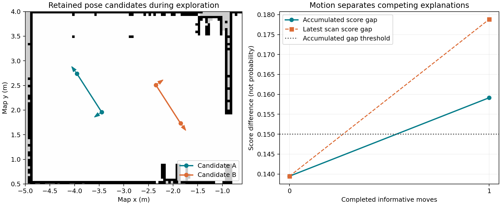

# 激光多候选与主动消歧实验

2026-10-30 · ROS 2 Humble / Gazebo Classic / Nav2 AMCL

## 结论

**已实现可选的激光全图多候选搜索与主动消歧。最终隔离 TF 的相似房间测试 3/3 恢复正确，每次主动移动一次，平均服务耗时 11.74 秒。**

**本轮同起点旧流程对照也为 3/3 正确，平均 4.43 秒，更快。因此当前证据不能证明新模式整体更好，尚未将其设为默认。**

完全对称且所有安全可达区域也相同的环境，仍然无法靠同一激光与相对里程计确定绝对位置。此实现仅利用地图已有的不对称结构，未修改地图、未添加传感器。

## 最终实现

- 在地图已知空闲区以 0.20 m / 5° 粗搜索，然后局部细化，保留最多 8 个分离位姿模式；评分只使用当前激光端点和地图。
- 同时要求最新扫描分数、连续观测平均分数的领先差达到门槛，并用另一帧扫描复核。分数不是概率，也不是正确定位保证。
- 歧义未消除时，在多个相对方向与 0.35 / 0.65 / 0.90 m 候选动作中，预测扫描差异，并最大化相对原地新增的区分度。
- 每个主要候选都必须有地图安全路径，实时激光也必须有足够净空；最多 3 步、总平移预算 1.8 m，保留传感器超时、导航取消及停车保护。
- 候选仅由移动前后的相对里程计增量推进。唯一候选通过算法自身的 /initialpose 交给 AMCL；AMCL 静止复核不通过或偏离该候选时返回失败。
- 无法唯一确定时返回失败，不回退到可能接受镜像解的旧成功判据。

## 隔离 TF 的测试方法

相似房间起点固定为 `(-3.5, 1.93, -2.52 rad)`。新旧流程均使用相同地图、激光频率、AMCL 参数与理想连续里程计测试夹具。

1. 将 Gazebo 原始里程计的搬动突跳从测试夹具输出中去除，发布 /continuous_odom，保持搬动前的连续坐标。
2. 单独启动 amcl_isolated。它只订阅 /hypothesis_tf 上的连续里程计动态变换，保留共享的传感器静态 TF；隔离原 Gazebo 动态 TF。
3. 重定位节点使用 /continuous_odom 和 /isolated_amcl_pose，并将 initialpose 与 AMCL 服务路由至隔离实例。
4. simulation_odom_validation=false，automatic_relocalization=false。机器人被搬动后由测试脚本调用恢复服务；没有用真值提供初始化位姿或成功验收。
5. Gazebo 真值/原始 odom 只由外部基准脚本用于测量最终误差，未送入上述隔离恢复链路。

这是模拟理想连续里程计的全局恢复测试；不是实机编码器噪声、滑移或自动绑架检测的完整验证。原始服务结果与外部位置误差分开保留。

## 新旧同点对照

外部正确标准：服务成功、位置误差 <0.15 m、航向误差 <5°、最终速度范数 <0.01。

| 流程 | 次数 | 外部验证正确 | 平均服务时间 (s) | 最大位置误差 (cm) | 最大航向误差 (°) |
|---|---:|---:|---:|---:|---:|
| 旧 AMCL 主动旋转流程 | 3 | 3/3 | 4.427 | 6.34 | 0.892 |
| 最终多候选主动消歧 | 3 | 3/3 | 11.739 | 5.60 | 1.639 |

| 新模式试次 | 服务时间 (s) | 主动移动次数 | 位置误差 (cm) | 航向误差 (°) | 最终速度 |
|---|---:|---:|---:|---:|---:|
| 1 | 11.696 | 1 | 5.60 | 1.072 | 0.000000 |
| 2 | 11.691 | 1 | 4.69 | 1.639 | 0.000000 |
| 3 | 11.830 | 1 | 5.27 | 1.559 | 0.000000 |

新旧测试未固定同一 AMCL 随机种子，样本各仅三次；该起点也用于调试，不能视为独立留出测试。不能据此估计普遍成功率或宣称新模式已解决所有对称错误。

## 候选如何被区分

下图来自最终隔离测试第 1 次。A 是最终选中且通过外部真值核对的候选，B 是竞争候选；左图为候选估计轨迹，不是外部测得的完整真实轨迹。移动后分数领先差越过保守门槛，才进入 AMCL 初始化。

## 其他验证与保留的失败

- 常规三位置各三次，共 9/9 外部验证正确；无需主动平移。它们来自动作增益修正前的同一候选搜索/验收链路，choose_action 未被调用，不能与最终隔离三次混作一个统一版本成功率。
- 初版隔离三次仅 2/3 成功。有一次虽当前正确候选分数较高，但平均领先差仍不足，探索步数耗尽后正确返回失败。
- 该失败暴露了按“未来绝对差异/动作代价”选动作会反复偏向短动作的问题。最终版本改成奖励相较原地新增的区分度；门槛、总距离与步数预算均未放宽。失败日志保留在 data/isolated_preliminary/。
- 主动转向断流测试通过：转向中暂停仿真，激光与里程计停更；约 1.507 秒后服务报告失败，暂停 0.6 秒后观测到 18 条速度命令，非零数为 0，恢复物理后速度为零。这一服务响应时间包含零速发送等待，不是停车触发延迟。
- 合成地图测试覆盖完全重复房间无法选出有增益动作、当前证据推翻历史自信、未知区域不可通行，以及绝对里程计原点变化不影响相对推进。
- 相关单元测试共 61 项通过；相关四个 CTest 测试套件通过；构建、修改 Python 文件的 flake8、新算法模块 pep257 与差异空白检查通过。未宣称整包历史 lint 已清零。

## 当前状态与使用

- 默认配置保留 active_hypothesis_relocalization=false；新模式为可选实验功能。
- 下述状态为实验结束时的记录，不代表读者启动后的运行状态。隔离测试夹具已停止。
- 最终机器人位于左上房间 (-3.5, 2.5)，速度 0.000，定位误差 6.00 cm，扫描评分 0.990。恢复正确位姿使用了激光候选匹配，没有用真值发布 initialpose。
- 实验开关与运行方法见项目 README；复现夹具见 reproduce/。

## 材料与复现

- data/isolated_revised/：最终三次隔离实验 CSV、分阶段计时、候选状态和服务原始日志。
- data/isolated_baseline/：相同起点的旧流程三次对照。
- data/isolated_preliminary/：修正前的 2/3 与失败样本。
- data/multi_position/：常规位置及早期相似房间测试。
- reproduce/：隔离夹具、参数和运行说明。原始状态与服务日志位于各 data/ 子目录。

下一步有价值的工作是将候选核对做成旧流程的按需补充，并用独立随机位姿与多种地图验证错误成功率。当前不应默认用更长的主动探索替换所有正常恢复。
